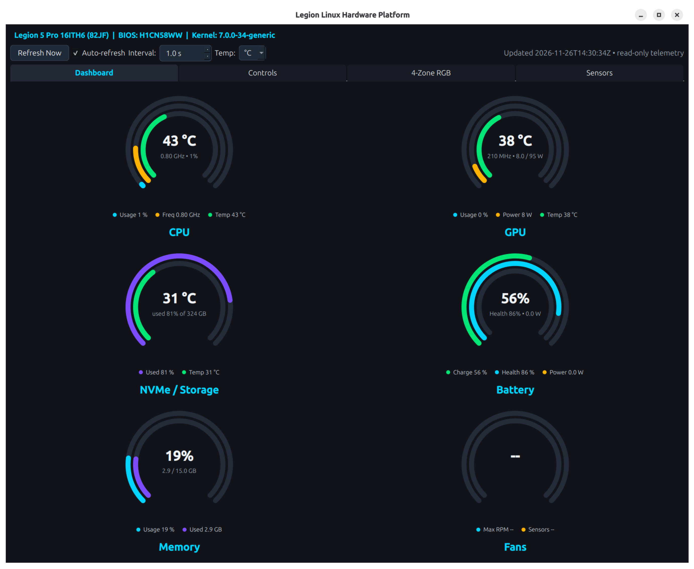
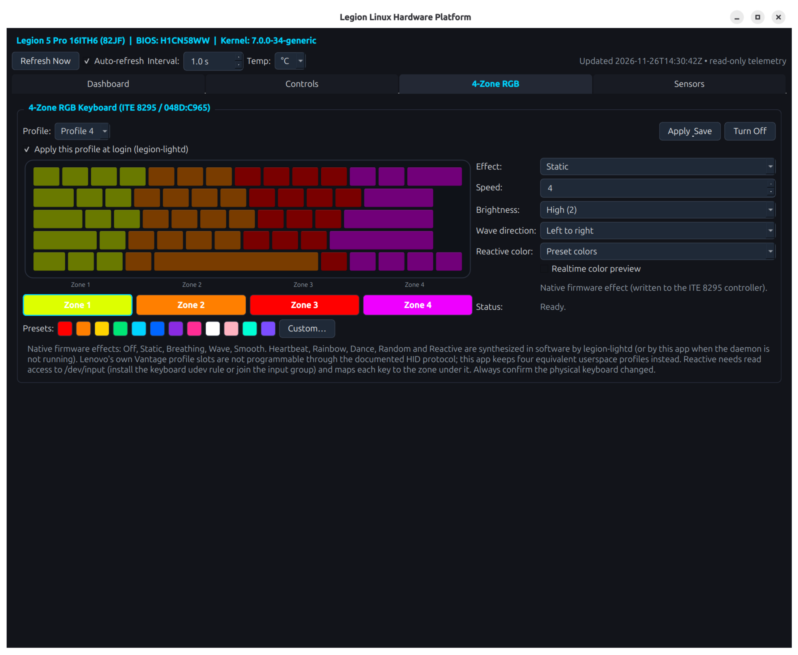

# Legion Linux Hardware Platform

A Linux desktop app for monitoring and controlling Lenovo Legion laptops, with the first validated target being the **Legion 5 Pro 16ITH6 (82JF)**.

The project separates read-only telemetry from privileged writes, keeps the GUI unprivileged, and treats every hardware capability as a state machine (`detected`, `readable`, `writable`, `applied`, `verified`, `temporarily_unavailable`, `unsupported`).

## Features

### Monitoring dashboard

- Large multi-arc gauges with separate rings and colours for each metric:
  - **CPU** — utilization, package power (or frequency when RAPL is unavailable), temperature, plus frequency text in the centre.
  - **GPU** — utilization, power against the reported max limit, temperature, clock and fan telemetry through `nvidia-smi`.
  - **NVMe / storage** — drive temperature and root filesystem usage.
  - **Battery** — charge, health and power draw.
  - **Memory** — usage and used/total GiB.
  - **Fans** — maximum RPM and sensor count from hwmon.
- User-selectable refresh interval from **0.1 s to 60 s** (single-shot scheduling prevents overlap).
- A **°C / °F** unit switch for the gauges and the sensor table.
- Full sensor and capability tables with source and state.

### Lenovo controls

- ACPI platform profile (`low-power`, `balanced`, `performance`, `custom`).
- Battery conservation mode, Fn lock, always-on USB charging, camera power.
- All writes go through the small allowlisted `legion-helper`; the GUI never runs as root.

### 4-zone RGB keyboard

- Four userspace lighting profiles, each with its own effect, speed, brightness, direction and zone colours.
- **Native firmware effects** written to the ITE 8295 controller:
  - Off, Static, Breathing, Wave (left-to-right / right-to-left), Smooth (hue cycle).
- **Software effects** animated by `legion-lightd` (or by the app when the daemon is not running):
  - Heartbeat, Rainbow (a continuous, seamless 4-zone hue shift), Dance/disco, Random, Reactive.
- **Reactive** flashes the zone under each physical key (preset per-zone colours or a random colour per press) with a smooth fade. It needs read access to `/dev/input` (see below).
- Painted keyboard preview with clickable zones, preset swatches and a full colour picker.
- **Realtime colour preview**: while editing a Static profile, colour changes can be written to the keyboard immediately.
- The daemon re-applies the saved profile at login and after suspend/resume (toggle **Apply this profile at login** in the RGB tab).

Lenovo Vantage's own four hardware slots are controlled by the EC and are **not** programmable through the documented HID protocol. This app therefore keeps four equivalent userspace profiles instead of pretending to edit Vantage's slots.

## Screenshots

| Dashboard | 4-zone RGB keyboard |
| --- | --- |
|  |  |

## Build

Requirements: CMake ≥ 3.20, a C++20 compiler, Ninja (recommended), Qt 6 Widgets, Linux headers for hidraw.

```bash
cmake -B build -G Ninja -DCMAKE_BUILD_TYPE=RelWithDebInfo
cmake --build build
ctest --test-dir build --output-on-failure
```

Binaries:

- `build/legion-gui` — desktop UI.
- `build/legion-cli` — read-only telemetry/JSON.
- `build/legion-helper` — narrow privileged helper (sysfs controls + RGB fallback).
- `build/legion-lightd` — unprivileged lighting daemon.

## Run

```bash
./build/legion-cli
./build/legion-cli --json
./build/legion-gui
```

## Install permissions and login service

The GUI writes RGB through `/dev/hidraw` using a udev `uaccess` rule, and other controls through a passwordless Polkit rule limited to the allowlisted helper.

```bash
sudo ./packaging/install-service.sh
./packaging/install-user-service.sh
```

The first command installs the helper, daemon and GUI, the RGB udev rule, the reactive keyboard-input udev rule, the Polkit rule, the icon and the desktop entry. The second installs and enables `legion-lightd.service` for your desktop user. Reconnect the keyboard or reboot after installing the udev rules.

> **Reactive input note.** `71-legion-keyboard-input.rules` grants the logged-in user read access to the internal keyboard event device so keypresses can flash lighting zones. This is the same capability as any input-reading utility; remove the rule to disable reactive physical-key input without affecting the other features.

Remove everything with:

```bash
./packaging/uninstall.sh          # user service
sudo ./packaging/uninstall.sh     # system files
```

## Lighting profiles

Profiles are stored at:

```text
~/.config/legion-linux-platform/lighting.conf
```

The daemon listens on `$XDG_RUNTIME_DIR/legion-lightd.sock` so the GUI can request an immediate reload after saving. If the daemon is not running, the GUI applies the profile directly and animates software effects itself. Hardware effects also fall back to `legion-helper` through Polkit when direct hidraw access is denied.

Validate a profile without touching hardware:

```bash
./build/legion-lightd --once --dry-run
```

## Safety and verification

- Read-only by default; hardware writes require an explicit UI action.
- No raw EC/PCI/MMIO writes, no voltage or clock overrides, no kernel modules.
- A successful HID write or sysfs write is reported as **write reported**, not as physical success. The physical keyboard must be confirmed by the user.
- CPU package power needs privileged RAPL access on many systems; when `energy_uj` is not readable the CPU gauge falls back to frequency and does not claim power telemetry.
- Fan gauges appear only when the kernel exposes hwmon fan inputs. On this machine the stock kernel exposes no fan sensors; LenovoLegionLinux/`legion_laptop` would add them.
- Reactive lighting reads the keyboard event device read-only and never grabs it, so normal typing is unaffected.
- Software effects run at a bounded frame rate and stop on write failure.

## Supported hardware

Validated on:

- **Lenovo Legion 5 Pro 16ITH6 (82JF)**, BIOS `H1CN58WW`, Ubuntu 26.04, kernel `7.0.0-34-generic`, NVIDIA RTX 3050 Ti Laptop GPU, 4-zone RGB keyboard `048d:c965`.

The RGB backend also lists the common ITE 8295 product IDs (`c955`, `c963`, `c965`, `c973`, `c975`, `c983`–`c985`, `c993`–`c995`), but those combinations still need physical validation.

## Repository layout

```text
core/        domain types, lighting model, config persistence, safe I/O
backends/    linux sysfs, evdev keyboard input, NVIDIA, Lenovo telemetry, ITE 8295 RGB, key map
apps/        GUI, CLI, helper, lighting daemon
packaging/   udev, Polkit, systemd user unit, desktop entry, installers
tests/       mocked telemetry and lighting protocol tests
docs/        decisions, compatibility matrix, test results, protocol notes, logo
```

## License

Licensed under the [Apache License, Version 2.0](LICENSE). See [LICENSE](LICENSE) for the full text.
